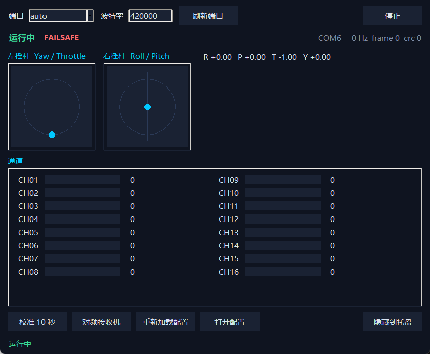

# ElrsSim

将 ExpressLRS（ELRS）接收机的 CRSF 串口数据转换为 Xbox 360 虚拟手柄，用于 FPV 穿越机模拟器。

提供 Windows 托盘 GUI 和命令行两种运行方式。当前版本：**0.1.1**。

## 主界面



> 截图为未连接接收机时的界面，因此显示 FAILSAFE；连接接收机并启动后会显示实时通道数据。

## 功能

- 解析 CRSF 串口数据，读取 16 个通道
- 将 Roll / Pitch / Throttle / Yaw 映射为虚拟 Xbox 360 手柄摇杆
- 支持通道反向、死区、Expo、摇杆校准
- 支持每个轴单独启用 `0..1` 输出，适配只接受 `0..1` 的游戏
- 支持通道值映射为手柄按钮
- 失联保护：超过设定时间未收到数据时自动回中，油门回最低
- GUI 托盘运行、单实例、DPI 适配
- 一键发送 CRSF 对频命令，让接收机进入 Bind 模式
- 命令行模式可用于查看通道、校准和排查串口问题

## 系统要求

- Windows 10 / 11（64 位）
- [ViGEmBus](https://github.com/nefarius/ViGEmBus/releases) 驱动
- CH340 USB 转串口模块（VID `1A86` / PID `7523`，程序会自动识别）
- ELRS 接收机，CRSF 输出，波特率 `420000`
- 源码运行需要 Python 3.9 或更高版本

## 下载与运行

1. 从 [Releases](https://github.com/HelloRuntu/ElrsSim/releases) 下载 `ElrsSim-v0.1.1.exe`。
2. 安装 ViGEmBus 并重启（如安装程序要求）。
3. 将 exe 放到任意目录并双击运行。
4. 首次启动会在 exe 同目录生成 `config.json`。

exe 未进行代码签名，Windows SmartScreen 可能提示“未知发布者”，选择“更多信息”后仍可运行。

## 使用说明

### GUI

1. 将 CH340 连接到电脑，接收机上电并完成与发射机的对频。
2. 在窗口顶部选择串口（默认 `auto`）和波特率 `420000`，点击“启动”。
3. 状态显示“运行中”后，打开模拟器并选择 Xbox 360 手柄。
4. 点击“校准”，在 10 秒内将 Roll / Pitch / Yaw 打到两端，油门保持最低；校准结果会写入配置文件。
5. 修改 `config.json` 后，点击“重新加载配置”即可生效。

关闭窗口默认隐藏到托盘，可从托盘菜单退出。

### 接收机对频

点击“对频接收机”会通过 CRSF 命令让接收机进入 Bind 模式，接收机通常开始双闪。之后仍需在发射机上执行 Bind。

对频功能需要：

- ELRS 3.4.0 或更高版本
- CH340 的 TX 连接到接收机的 CRSF RX
- 3.3V 电平并共地
- 不要同时连接飞控的 TX 和 CH340 的 TX

### 命令行

```powershell
# 列出串口并自动识别 CH340
python run.py --list

# 只查看通道，不创建虚拟手柄
python run.py --monitor

# 指定串口运行
python run.py --port COM6

# 校准 10 秒并保存到 config.json
python run.py --calibrate 10
```

## 配置说明

源码运行时配置文件位于仓库根目录 `config.json`；exe 运行时位于 exe 同目录。若该目录不可写，会回退到 `%LOCALAPPDATA%\ElrsSim\config.json`。

默认轴映射：

| 轴 | CRSF 通道 | 手柄 |
| --- | --- | --- |
| Roll | CH1 | 右摇杆 X |
| Pitch | CH2 | 右摇杆 Y |
| Throttle | CH3 | 左摇杆 Y |
| Yaw | CH4 | 左摇杆 X |

默认按钮映射：

| 条件 | 手柄按钮 |
| --- | --- |
| CH5 高位 | A |
| CH6 低位 | B |
| CH6 高位 | X |

### 每轴 0..1 输出

每个轴都有独立的 `map_0_1` 选项：

```json
"axes": {
  "roll":     { "channel": 1, "map_0_1": false },
  "pitch":    { "channel": 2, "map_0_1": false },
  "throttle": { "channel": 3, "map_0_1": true  },
  "yaw":      { "channel": 4, "map_0_1": false }
}
```

启用后，该轴最终写入虚拟手柄的值会从 `-1..1` 线性映射为 `0..1`（中心为 `0.5`）。适用于只接受 `0..1` 输入的游戏。GUI 中的摇杆和数值仍按 `-1..1` 显示。

失联时，如果油门启用了 `map_0_1`，输出为 `0`；其余启用 `map_0_1` 的轴输出为 `0.5`。

### 其他常用配置

- `serial.port`：`auto` 或 `COM6`
- `serial.baud`：默认 `420000`
- `update_hz`：虚拟手柄更新频率上限，默认 `500`；实际随 CRSF 帧到达即时更新
- `failsafe_timeout_ms`：失联判定时间，默认 `250`
- `failsafe_throttle`：失联油门值，默认 `-1.0`
- `axes.<name>.invert`：反向
- `axes.<name>.deadband`：死区
- `axes.<name>.expo`：Expo 曲线
- `calibration`：每个通道的 min / center / max
- `buttons`：通道位置到手柄按钮的映射
- `button_low` / `button_high`：按钮高低位阈值

## 构建

```powershell
python -m pip install -r requirements-build.txt
.\build.ps1
```

输出文件为 `dist\ElrsSim.exe`。构建脚本会安装依赖、生成图标并调用 PyInstaller。

## 测试

```powershell
python -m unittest discover -s tests -v
```

## 日志

运行日志位于：

```text
%LOCALAPPDATA%\ElrsSim\elrs_sim.log
```

遇到串口、手柄或对频问题时，可先查看该日志。

## 性能建议

- 程序按 CRSF 帧到达即时更新虚拟手柄，`update_hz` 只作为更新频率上限。
- 如果 CH340 驱动提供 Latency Timer 选项，将其设为 `1 ms` 可进一步降低串口延迟（设备管理器 → 端口 → USB-SERIAL CH340 → 属性 → 高级）。
- 关闭不使用的串口监视器、手柄映射工具或录制软件，避免额外占用串口和输入设备。
- GUI 以 20 Hz 刷新显示，不影响虚拟手柄的实际输出频率。

## 常见问题

- **找不到 CH340**：确认驱动已安装、换 USB 口，并用 `python run.py --list` 检查。
- **有通道数据但游戏没反应**：确认 ViGEmBus 正常、模拟器中已选择 Xbox 360 手柄。
- **油门方向相反**：将 `axes.throttle.invert` 设为 `true`，或在发射机上调整通道方向。
- **对频无反应**：确认 CH340 TX 已接到接收机 CRSF RX、电平为 3.3V，并已升级到 ELRS 3.4.0 以上。
- **摇杆中位不准**：重新执行校准，并检查发射机的通道中位。

## 校验

`v0.1.1` 发布文件：

```text
SHA256  8C434D933C20AA15CA17667F4644331A8547AD0E05E0A993A7E8A5FC46FCF56A  ElrsSim-v0.1.1.exe
```

## 说明

本项目与 ExpressLRS、Betaflight、Microsoft 无关联。使用风险自负。
